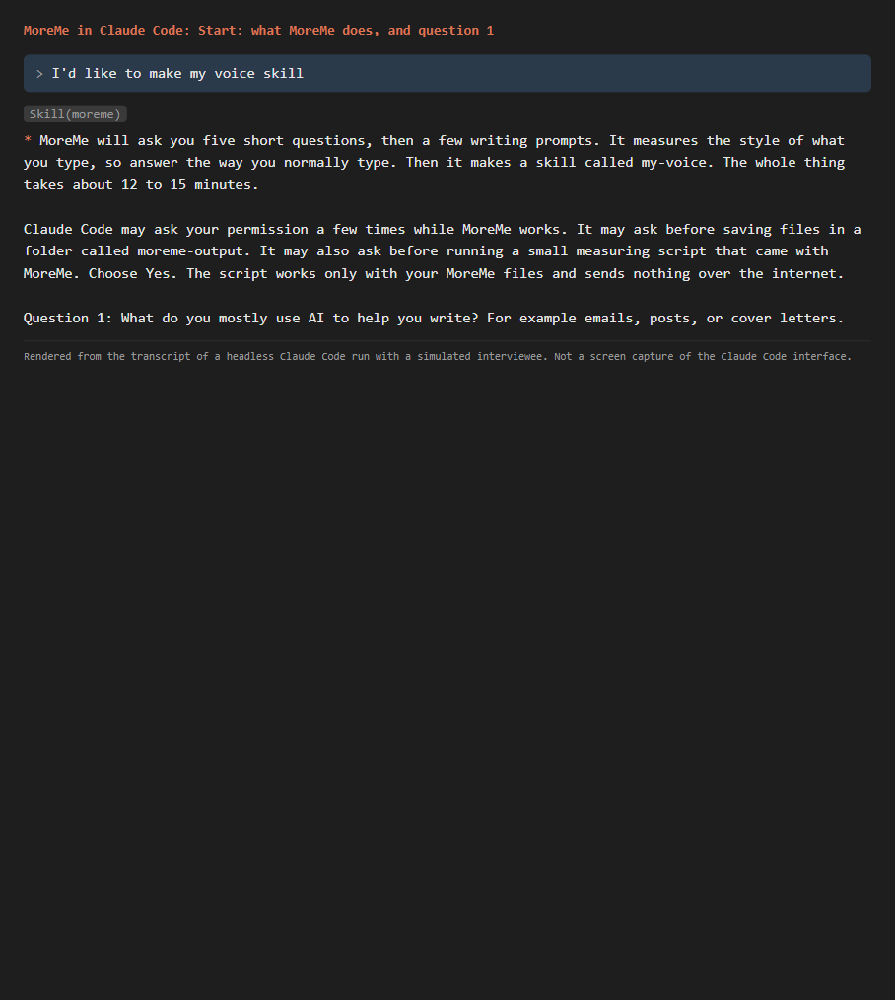

# MoreMe

MoreMe is a Claude skill that learns how you write and turns it into a second skill, called **my-voice**. After that, when you ask Claude to draft an email, a post, or a cover letter, it writes the way you do.

It takes about 12 to 15 minutes. You answer two quick questions, talk about something you care about for a few minutes, and pick between two drafts.

*Rendered from the transcript of a headless Claude Code run with a simulated interviewee. Not a screen capture of the Claude Code interface.*

## What happens

1. **Interview.** Two quick questions: what you mostly use AI to write, and what bugs you in drafts AI writes for you.
2. **Talking.** MoreMe asks about something you could go on about (a team, a hobby, a show, something that happened this week), then asks follow-up questions about what you said. You type until you reach about 300 words. Your interview answers count too. You never paste old writing.
3. **Analysis.** A small script that ships with MoreMe measures your style: sentence length, punctuation, contractions, how you start sentences, and more. You see a plain-language report and get to say if it sounds like you.
4. **Your skill.** MoreMe writes `my-voice`: a summary of how you sound, your real numbers in plain words, do and don't rules, and short examples taken from what you typed.
5. **Blind A/B.** Claude writes the same message twice, once with your new skill and once without. You pick the one that sounds more like you before you learn which is which.
6. **Install.** MoreMe puts my-voice where Claude can find it.

Example output: [docs/example-run/my-voice/SKILL.md](docs/example-run/my-voice/SKILL.md) (from a test run with a simulated writer).

## Install

You need [Claude Code](https://claude.com/claude-code) or a paid claude.ai plan. Python 3.8 or newer lets MoreMe measure your writing; without Python it still runs, but the analysis is a rough estimate and says so.

First get the files: on this page choose **Code**, then **Download ZIP**, and unzip it. You need the `moreme` folder inside.

### Claude Code, one project

Status: run end to end by an automated headless test on Windows.

1. In the project folder you work in, make a folder called `.claude`, and inside it a folder called `skills`.
2. Copy the `moreme` folder into it, so you have `.claude/skills/moreme/SKILL.md`.
3. Open Claude Code in that project and say: **"I'd like to make my voice skill."**

### Claude Code, every project

Status: written from Anthropic's documentation. The install command is tested, but this route was not run end to end.

Same as above, but copy `moreme` into the `.claude/skills` folder in your home folder (on Windows, `C:\Users\<you>\.claude\skills`; on a Mac or Linux, `~/.claude/skills`). At the end, MoreMe offers to install my-voice there too, so it works in every project.

### claude.ai

Status: written from Anthropic's help pages. Not tested.

Needs a paid plan with code execution turned on. Zip the `moreme` folder (right-click it, then "Compress"), then in claude.ai open Settings, then Features (sometimes called Capabilities), and upload the zip under Skills. Start a new chat and ask to make your voice skill.

## Does it work?

We tested MoreMe on six writers: two modern writers with openly licensed text and four public-domain writers. MoreMe built a my-voice skill for each one. Then Claude (Sonnet 5.5) wrote 8 held-out tasks per writer, 5 times each: twice with the skill, twice without it, and once with three of the writer's own passages added to the prompt. That made 240 drafts, all valid. The method, the metrics, and the exact headline sentence were written down and hash-frozen before any held-out draft existed ([eval/PREREGISTRATION.md](eval/PREREGISTRATION.md)).

The test: for each draft, a function-word style measure that the skill never sees picks which of the six writers the draft sounds most like.

**With the skill, a style measure the skill never saw picked the right writer for 35% of drafts, compared with 21% without it (difference 14.6 points, 95% CI 4.2 to 26.0; chance is 17%).**

| | Right writer picked |
|---|---|
| Without the skill | 21% |
| With the skill | 35% |
| Writer's own passages added to every prompt | 52% |

What this means:

- The skill helps, and the gain is unlikely to be chance.
- Adding real samples to each prompt did better still. The skill's advantage is that you set it up once and it applies everywhere, without adding samples to every prompt.
- The effect varies a lot by writer. Both modern writers showed no change. Three of the four older writers showed large gains. With 8 tasks per writer, the per-writer numbers are only descriptive.
- Claude used the skill on its own in 94 of the 96 drafts where it was installed.

Full tables: [eval/results/heldout/report.md](eval/results/heldout/report.md).

### Before and after

This pair was picked by a rule fixed in advance: the task whose improvement was closest to the median, not the best one. It is a typical result, so the difference is small. The task: "Write an email to a colleague about a business book you read recently and what your team can take from it." Opening lines, verbatim:

> **Without the skill:** I finished *Atomic Habits* by James Clear last weekend, and I think it has some practical ideas for how we run our team. I know it's usually shelved under self-help, but the framework applies well to the way we work. I wanted to share the highlights while they're fresh.

> **With the skill:** I finished *Team of Teams* by Stanley McChrystal last week. I think our team can use several of its ideas right away.
>
> The main point is simple. Large organizations built around strict chains of command are good at efficiency, but they're slow to adapt.

Full drafts: [without](eval/results/heldout/drafts/modern-b-heldout-04-without-r1.json), [with](eval/results/heldout/drafts/modern-b-heldout-04-with-r1.json).

### What went differently from the plan

- Claude Code updated itself from 2.1.303 to 2.1.306 during the run. 32 drafts came from the old version and 208 from the new one. The harness now stops when the version changes instead of retrying.
- That retry bug, plus a rate-limit check that stayed blocked after the limit had reset, wasted about 235 calls. The whole project used about 990 model calls against a plan of 690 to 710.
- Both fixes are logged in the "Deviations after freezing" section of the preregistration.
- The eval skills were built with an earlier version of the writing step, which asked for short pieces of writing (a story, a reply, an opinion) instead of a topic you pick. The current version finds a topic you care about and follows up on what you say. It was checked end to end but not re-scored.

## Privacy

- MoreMe has no server and uploads nothing of its own. The measuring script (`moreme/analyze.py`) uses only Python's standard library, opens no network connections (a test checks this), and writes only to a `moreme-output` folder in your project.
- Claude itself sees what you type, as it does in any chat, under Anthropic's terms. On claude.ai, the script runs in Claude's sandbox, not on your computer.
- In Claude Code, `moreme-output` comes with a `.gitignore`, so your writing stays out of git.

## Limitations

- **It learns how you type to Claude.** The sample is what you write in the chat. That can be more casual than an email you would polish.
- **About 300 words is a small sample.** The numbers are a rough picture, and the report says so when the sample is short.
- **Tested headless, with simulated writers.** The end-to-end tests drove Claude Code from a script, with an AI agent playing the user and answering MoreMe's questions with real passages from public-domain and openly licensed writers. No real person was timed, so "12 to 15 minutes" is an estimate.
- **Only Windows was run.** Tests pass on Windows with Python 3.8, 3.11, and 3.12. A CI workflow for macOS, Linux, and Windows is included but has not run yet.
- **Claude only, for now.** ChatGPT and Gemini support is future work.
- **Runs vary.** In the reference test run (`e2e-20261022-r8`) every step worked, with one formatting slip in the A/B message, since fixed. In the next run (`r9`) Claude skipped showing the style report in chat. Both are in `eval/e2e/runs/`.
- Two small known issues: the running word count in the talking step can be off by 10 to 15%, and a short internal note can sometimes show up in the chat.

## How it was tested

- `python -m pytest`: the analysis script, the skill files, the eval harness, a privacy check on every tracked file, and a prose check (no long dashes or stock AI phrases in user-facing text). Results: [docs/PROOF.md](docs/PROOF.md).
- End-to-end runs of the whole flow, scored against a rubric by a separate reviewer agent: [docs/e2e-rubric.md](docs/e2e-rubric.md), runs in `eval/e2e/runs/`.
- The eval method, written down before any held-out text was scored: [eval/PREREGISTRATION.md](eval/PREREGISTRATION.md).

## Files

| Path | What it is |
|---|---|
| `moreme/` | The skill: `SKILL.md`, the measuring script, reference notes, and the my-voice template |
| `docs/` | Demo, example output, rubric, test results, proof checklist |
| `eval/` | Corpus (with sources and licenses), harness, persona skills, results |
| `tests/` | pytest suite |
| `tools/` | Prose checker, privacy sanitizer, demo builders |

## License

The code is MIT licensed (see [LICENSE](LICENSE)). The writing samples in `eval/corpus/` keep their own licenses (public domain, Open Government Licence v3.0, CC BY-SA 4.0); see [eval/corpus/LICENSE-CORPUS.md](eval/corpus/LICENSE-CORPUS.md).
